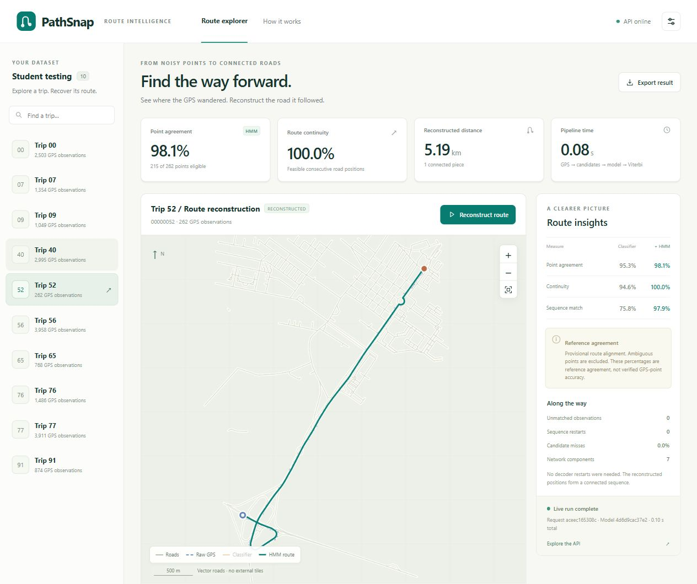
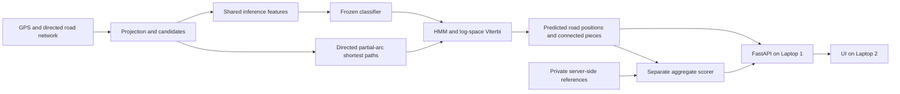

# PathSnap

An end-to-end local system for matching noisy GPS observations to a directed road network and reconstructing connected routes. It includes the data/feature pipeline, five classifier experiments, Bayesian optimisation, graph transitions, HMM/Viterbi, isolated scoring, FastAPI, an offline-capable browser interface, Folium maps and a consolidated technical report.



## Run the application

Python 3.11, from the project root in PowerShell:

```powershell
.\scripts\setup.ps1
.\scripts\start_api.ps1
```

Open [PathSnap](http://127.0.0.1:8000/ui/). A trained model is included, so retraining is unnecessary for the demo. Keep the supplied data at `Student folder/Student folder/{train,student_test}/<trip_id>/`, or configure another data root.

For two laptops, run `scripts/start_api.ps1 -Lan` on Laptop 1 and `scripts/start_ui.ps1` on Laptop 2. Open `http://localhost:8001` on Laptop 2 and enter Laptop 1's API address in connection settings. Full instructions, CORS, alternate data paths and final-evaluator conventions are in [DEPLOYMENT.md](DEPLOYMENT.md).

## Measured development results

| Measure | Classifier only | Classifier + HMM |
|---|---:|---:|
| Eligible point agreement | 85.91% | 90.36% |
| Feasible route continuity | 91.38% | 99.75% |
| Mean ordered route edit similarity | 44.29% | 75.65% |

These are actual results on ten student-testing trips. Point agreement uses **15,068 eligible provisional reference alignments out of 19,160 observations**, not independently verified GPS-point truth. Every observation receives a prediction/status; excluded-label counts are reported separately. Detailed definitions, per-trip results, limitations and figures are in the [technical report source](results/full/technical_report.md) and [report PDF](output/pdf/PathSnap_Technical_Report.pdf).

The five required models were compared on the same five trip-grouped folds. Untuned Histogram Gradient Boosting was retained because the 12-trial Bayesian search did not improve its CV objective. Training uses a declared budget of up to 200 eligible observations per trip across all 80 training trips; CV evaluates up to 400 eligible observations per held-out trip. See [MEMBER2_README.md](MEMBER2_README.md) for the ML protocol.

## Architecture



Prediction never opens references. Every `/predict` request runs fresh inference; precomputed demonstration predictions are not used as lookup answers. Only the UI directory is served as static content. Reference route IDs, geometry and pointwise correctness are not returned to the UI.

## Project layout

```text
pathsnap_ml/       Features, offline alignment, five models, CV and Bayesian search
pathsnap/          Directed graph, Viterbi, geometry, scoring, Folium, report source
api/               FastAPI /health, /trips, /predict and local UI hosting
ui/                Buildless responsive UI and offline vector map
configs/           Shared ML and selected decoder settings
artifacts/member2/ Model bundles and provenance metadata
scripts/           Setup, launch, experiments, checks, report and archive builders
tests/             Geometry, leakage, decoding, metrics and API integration checks
results/member2/   Classifier CV/trials/results/plots and label audits
results/full/      EDA, decoder trials/results, Folium maps and verification evidence
output/pdf/        Consolidated technical report
```

## Verify and reproduce

```powershell
.\.venv\Scripts\python.exe scripts/check_project.py
.\.venv\Scripts\python.exe scripts/smoke_api.py
.\.venv\Scripts\python.exe scripts/run_member2.py all
.\.venv\Scripts\python.exe scripts/verify_member2.py
.\.venv\Scripts\python.exe scripts/run_member2.py report
.\.venv\Scripts\python.exe scripts/run_project.py all
.\.venv\Scripts\python.exe scripts/build_report_pdf.py
```

The smoke check needs the API running; it verifies all ten student-testing trips over real HTTP. Automated checks passed **34 tests**. Browser checks verified desktop/mobile rendering, trip selection/search, layer controls, zoom/fit, replay, and a separately hosted UI calling the API. See saved JSON/text evidence under `results/full/`.

## Evaluation and submission status

The role split in [PROJECT_WORKFLOW.md](PROJECT_WORKFLOW.md) remains the team review/report ownership. Following the user's subsequent full-project request, all three implementation workstreams are now present locally.

Official pointwise alignment still requires organiser/team validation. Configure reserved evaluator inputs and private references only for authorised final evaluation; they are not included in this dataset. A physical two-laptop LAN rehearsal and receiving-laptop terminal screenshot remain tasks for the actual event setup. This local build does not publish a GitHub repository or submit to the organisers.

The project archive excludes raw data, runtime environments and caches. The saved models are small enough for normal Git inclusion and are no longer ignored. Keep evaluator references and credentials out of the public repository. Review the report against actual experiments, understand every component, and disclose AI assistance as required by event policy.
