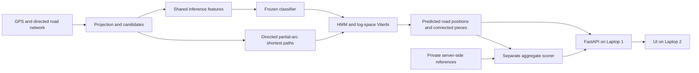

# PathSnap

An end-to-end local system for matching noisy GPS observations to a directed road network and reconstructing connected routes. It includes the data/feature pipeline, six classifier experiments including LightGBM, Bayesian optimisation, graph transitions, HMM/Viterbi, isolated scoring, FastAPI, an offline-capable browser interface, Folium maps and a consolidated technical report.


## Run the application

Python 3.11, from the project root in PowerShell:

```powershell
.\scripts\setup.ps1
.\scripts\start_api.ps1
```

Open [PathSnap](http://127.0.0.1:8000/ui/). A trained model is included, so retraining is unnecessary for the demo. Keep the supplied data at `Student folder/Student folder/{train,student_test}/<trip_id>/`, or configure another data root.

For two laptops, run `scripts/start_api.ps1 -Lan` on Laptop 1 and `scripts/start_ui.ps1` on Laptop 2. Open `http://localhost:8001` on Laptop 2 and enter Laptop 1's API address in connection settings. Full instructions, CORS, alternate data paths and final-evaluator conventions are in [DEPLOYMENT.md](DEPLOYMENT.md).

For the final demo, keep the supplied `evaluator_test` directory on Laptop 1 and start its API in evaluator mode:

```powershell
.\scripts\start_api.ps1 -Lan -Partition evaluator_test -ReferenceRoot (Resolve-Path .\evaluator_test).Path
```

The UI lists the ten evaluator trips and lets you run any of the six saved classifiers with the shared decoder. HGB remains the default selected by training cross-validation.

## Measured development results

| Measure | Classifier only | Classifier + HMM |
|---|---:|---:|
| Eligible point agreement | 85.91% | 90.36% |
| Feasible route continuity | 91.38% | 99.75% |
| Mean ordered route edit similarity | 44.29% | 75.65% |

These are actual results on ten student-testing trips. Point agreement uses **15,068 eligible provisional reference alignments out of 19,160 observations**, not independently verified GPS-point truth. Every observation receives a prediction/status; excluded-label counts are reported separately. Detailed definitions, per-trip results, limitations and figures are in the [technical report source](results/full/technical_report.md) and [report PDF](output/pdf/PathSnap_Technical_Report.pdf).

## Classifier comparison

Six classifiers use the same features, five trip-grouped folds, and sampling protocol. Training uses up to 200 eligible observations per trip across all 80 training trips, with validation on up to 400 eligible observations per held-out trip.

| Model | Grouped-CV candidate F1 | Student candidate F1 | Student point agreement |
|---|---:|---:|---:|
| Logistic Regression | 0.887401 | 0.904692 | 85.13% |
| Distance-weighted KNN | 0.891221 | 0.911373 | 84.53% |
| Decision Tree | 0.895788 | 0.912632 | 85.11% |
| Random Forest | 0.901464 | 0.917506 | 85.36% |
| Histogram Gradient Boosting | 0.905646 | 0.920494 | 85.91% |
| LightGBM | 0.905305 | 0.920337 | 85.96% |

HGB and LightGBM each use 12 Bayesian tuning trials. HGB is the default under the selection rule of highest training-CV candidate Macro F1. HGB tuning retained its baseline configuration. LightGBM's selected configuration uses 91 trees, learning rate 0.118846, 25 leaves, a minimum of 70 samples per leaf, and L2 regularization of 0.615846.

| Route measure | HGB + HMM | LightGBM + HMM |
|---|---:|---:|
| Point agreement | 90.36% | 90.42% |
| Continuity | 99.75% | 99.75% |
| Sequence similarity | 0.756493 | 0.753936 |

Both classifiers use the same decoder, whose parameters were selected with HGB emissions on the training development subset. Point agreement uses 15,068 provisional alignments. See [MEMBER2_README.md](MEMBER2_README.md) for the shared protocol and the [complete model table](results/lightgbm/model_comparison.csv).

## Architecture



Prediction never opens references. Every `/predict` request runs fresh inference; precomputed demonstration predictions are not used as lookup answers. Only the UI directory is served as static content. Reference route IDs, geometry and pointwise correctness are not returned to the UI.

## Project layout

```text
pathsnap_ml/       Features, offline alignment, five models, CV and Bayesian search
pathsnap/          Directed graph, Viterbi, geometry, scoring, Folium, report source
api/               FastAPI /health, /trips, /predict and local UI hosting
ui/                Responsive route dashboard with street and local basemaps
configs/           Shared ML and selected decoder settings
artifacts/member2/ Model bundles and provenance metadata
scripts/           Setup, launch, experiments, checks, report and archive builders
tests/             Geometry, leakage, decoding, metrics and API integration checks
results/member2/   Classifier CV/trials/results/plots and label audits
results/lightgbm/  Classifier comparison, Bayesian trials and paired decoder results
artifacts/lightgbm/ LightGBM bundle and provenance
results/full/      EDA, decoder trials/results, Folium maps and verification evidence
output/pdf/        Consolidated technical report
```

## Verify and reproduce

```powershell
.\.venv\Scripts\python.exe scripts/check_project.py
.\.venv\Scripts\python.exe scripts/smoke_api.py
.\.venv\Scripts\python.exe scripts/run_member2.py all
.\.venv\Scripts\python.exe scripts/verify_member2.py
.\.venv\Scripts\python.exe scripts/run_member2.py report
.\.venv\Scripts\python.exe scripts/run_project.py all
.\.venv\Scripts\python.exe scripts/build_report_pdf.py
```

The smoke check needs the API running; it verifies all ten student-testing trips over real HTTP. Automated checks passed **34 tests**. Browser checks verified desktop/mobile rendering, trip selection/search, layer controls, zoom/fit, replay, and a separately hosted UI calling the API. See saved JSON/text evidence under `results/full/`.

## Evaluation and submission status

The role split in [PROJECT_WORKFLOW.md](PROJECT_WORKFLOW.md) remains the team review/report ownership. Following the user's subsequent full-project request, all three implementation workstreams are now present locally.

Use `python scripts/run_evaluator.py` to run the six saved classifiers on all ten evaluator trips. The [aggregate evaluation](results/full/evaluator_summary.json) and technical report record both classifier-only and classifier-plus-HMM results. The supplied ordered routes support sequence scoring and provisional point agreement. A physical two-laptop LAN rehearsal and receiving-laptop terminal screenshot remain tasks for the actual event setup.

The project archive excludes raw data, runtime environments and caches. The saved models are small enough for normal Git inclusion and are no longer ignored. Keep evaluator references and credentials out of the public repository. Review the report against actual experiments, understand every component, and disclose AI assistance as required by event policy.
