# PathSnap Technical Report

Distributed map matching and route reconstruction. This consolidated report documents the implemented data pipeline, six classifier experiments, Bayesian optimisation, directed-graph HMM/Viterbi reconstruction, local API and evaluator interface. It reports actual saved experiments and identifies the remaining evaluation setup checks.

## 1 Project outcome and evaluation status

The complete application processed all ten supplied student-testing trips (19,160 observations). On 15,068 eligible derived labels, classifier-only agreement was 0.8591 and HMM agreement was 0.9036. Feasible continuity across comparable adjacent observations increased from 0.9138 to 0.9975. All 10 trips improved overall point agreement.

**Reference limitation:** supplied route files list traversed arcs. Point agreement uses a provisional ordered reference alignment and excludes ambiguous or distant points. Model features and derived labels share geometric cues, which can inflate agreement. The isolated scorer also accepts official pointwise labels when supplied.

## 2 Dataset understanding and exploratory data analysis

| Partition | Trips | GPS observations | Missing / invalid coordinates | Largest time gap (s) |
| --- | --- | --- | --- | --- |
| student_test | 10 | 19,160 | 0 / 0 | 210 |
| train | 80 | 208,417 | 0 / 0 | 153064 |

The data is grouped by trip. Track files contain longitude, latitude and timestamp; nodes contain longitude and latitude; arcs contain directed node pairs. Original row indices identify observations, nodes and arcs. Routes contain chronological local arc IDs. IDs are never pooled as universal road classes, and trips stay in their declared partitions.

Coordinates span several geographical regions. The pipeline projects each trip into spherical azimuthal-equidistant metre coordinates around its GPS median, retaining the original longitude/latitude for display. This is an explicit spherical approximation rather than an ellipsoidal CRS; extents above ten degrees from the origin are rejected for manual projection selection. 96.68% of time steps are one second. There are no non-increasing timestamps or missing GPS rows in these supplied partitions. The largest training gap is 153,064 seconds; long gaps are handled as sequence breaks. Zero-length arcs are preserved by original ID and guarded against division by zero.

The road graph preserves directed and parallel arcs, weights each by projected length, computes weak components and uses a bounded shortest-path cache. Candidate retrieval samples complete segments, queries a spatial index, then applies exact projected point-to-segment distances. This includes long-edge interiors, not just endpoints. Up to eight nearby candidates are retained; radius expands from 50 m to 100/250 m only if the smaller radius returns none. Neither candidates nor features use reference-route membership.

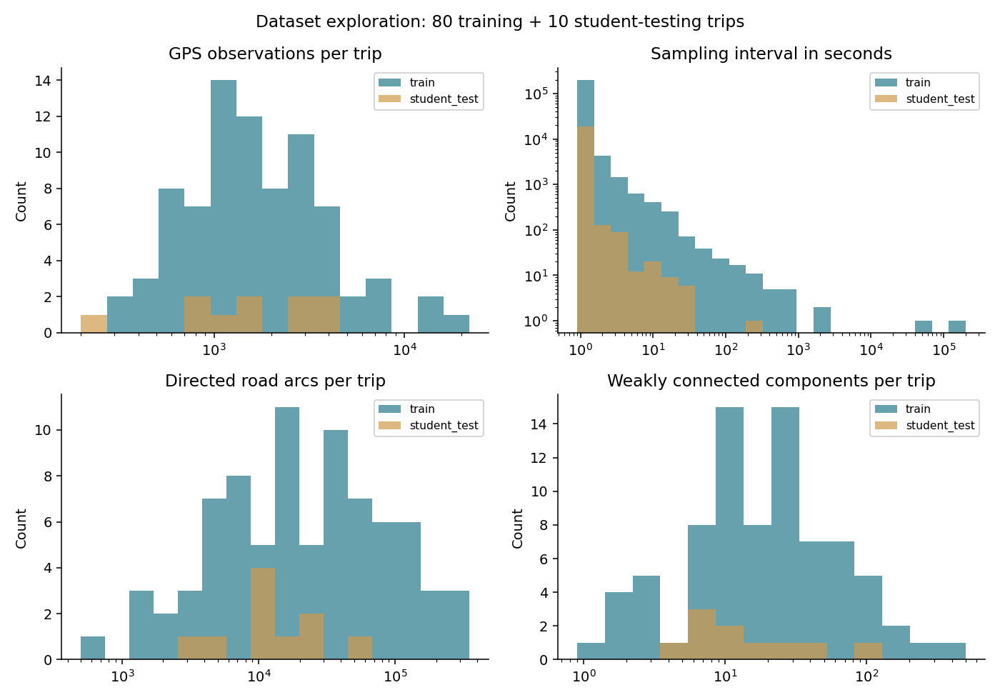

## 3 System architecture

Laptop 1 loads the frozen classifier, raw GPS/network, graph transition policy and decoder. The inference sequence is validation -> per-trip projection -> candidates -> shared feature pipeline -> classifier probabilities -> directed transition distances -> log-space Viterbi -> connected geometry pieces. Only after prediction finishes does a separate scorer open references and compute aggregate metrics. Laptop 2 selects a trip ID, sends a real HTTP request and displays predicted geometry, aggregate metrics, timings and route breaks. No evaluator reference geometry, arc sequence or pointwise correctness is returned.

## 4 Feature engineering classifier experiments and Bayesian optimisation

| Model | Family | Key configuration | CV candidate F1 | Student Top-1 | Route continuity | Student candidate F1 | Log loss | Inference s |
| --- | --- | --- | --- | --- | --- | --- | --- | --- |
| Logistic Regression | Linear probabilistic | C=1; scaled | 0.8874 | 0.8513 | 0.9101 | 0.9047 | 0.1458 | 0.0118 |
| Distance-weighted KNN | Instance based | k=15; distance weights; scaled | 0.8912 | 0.8453 | 0.9060 | 0.9114 | 0.1871 | 12.4797 |
| Decision Tree | Tree | depth=10; leaf=20 | 0.8958 | 0.8511 | 0.9054 | 0.9126 | 0.1413 | 0.0064 |
| Random Forest | Bagged tree ensemble | 100 trees; depth=14; leaf=10 | 0.9015 | 0.8536 | 0.9112 | 0.9175 | 0.1146 | 0.3120 |
| Histogram Gradient Boosting | Boosted tree ensemble | 120 rounds; rate=.08; 15 leaves | 0.9056 | 0.8591 | 0.9138 | 0.9205 | 0.1104 | 0.0939 |
| LightGBM | Boosted tree ensemble | 91 trees; rate=.11885; 25 leaves; leaf=70 | 0.9053 | 0.8596 | 0.9136 | 0.9203 | 0.1099 | 0.1285 |

The consolidated table combines measured classifier CV/student diagnostics with classifier-only graph continuity on all student GPS observations. Candidate F1 and observation Top-1 use the eligible-label protocol; continuity uses all comparable adjacent observations. Details of precision, recall, timings and each model follow.

## Status and interpretation

**All reference-based results below measure agreement with eligible provisional labels derived from the ordered supplied routes. They are not independently verified GPS-point accuracy.** No official pointwise mapping was supplied during this work. The same distance/heading geometry influences derived labels and input features, which can inflate measured agreement. Member 1 must review alignment quality; replace labels and rerun if an official mapping becomes available. Excluding ambiguous or distant observations also biases these results toward the more confidently aligned subset.

All 80 training trips and ten student-testing trips were processed. Training alignment accepted 146,211 of 208,417 observations; student-testing alignment accepted 15,068 of 19,160. Excluded points remain in inference outputs. Student-testing candidate miss rate on the eligible subset is 0.226%. Candidate policy was fixed before model comparison; no reference arc was added to validation candidates.

### Feature engineering

We model each observation-candidate pair as a binary compatibility problem. Arc IDs and trip IDs remain metadata. This supports road networks whose IDs are local to each trip. Features use GPS observations and road geometry only; no reference-route membership or reference-derived feature enters prediction.

`distance_m`, `heading_difference_rad`, `heading_valid`, `projection_fraction`, `road_length_m`, `from_in_degree`, `from_out_degree`, `to_in_degree`, `to_out_degree`, `speed_mps`, `time_gap_s`, `distance_rank`, `relative_distance_m`, `candidate_count`, `search_radius_m`, `zero_length_arc`.

Distances and fractions describe spatial fit. Directed heading difference disambiguates opposing arcs; a separate validity flag suppresses unreliable heading during low movement, anomalous speed or long gaps. Length and endpoint degrees describe road context. Speed and time gap describe sampling/motion conditions. Rank, relative distance, candidate count and search radius describe local competition. Zero-length arcs are flagged and projected without division by zero. The first point uses no future observation for its motion features.

The development geospatial adapter uses per-trip spherical azimuthal-equidistant coordinates and a sampled-segment spatial index with exact planar filtering. Candidate radius starts at 50 m and expands to 100/250 m only when no candidate exists; at most eight directed arcs are retained. This is a temporary Member 1 adapter pending shared geometry review, not an ellipsoidal projection or a guarantee of reference coverage.

### Reference label preparation

The offline aligner considers up to eight route occurrences per observation, scores geometric/heading compatibility and backtracks an ordered path through reference progress. Repeated arc occurrences are preserved. Large GPS gaps and infeasible progress cause explicit resets; reference discontinuities are kept as separate chunks. Eligibility requires a reference distance at most 50 m, an emission margin at least 0.15, local consistency and distance from reference-break endpoints. Post-initial resets are excluded. These are fixed provisional heuristics, not validated confidence probabilities. Per-point decisions are saved in `alignment_audits/` for manual review.

### Training and evaluation protocol

The five fixed group folds each hold out 16 complete training trips and fit on the remaining 64. Up to 200 eligible, candidate-covered observations per training trip are selected deterministically; all their candidates are retained. Each final untuned model fits 16,000 observations and 96,698 candidate rows drawn from all 80 trips. This is a laptop-budget experiment, not fitting every available GPS observation. CV evaluates up to 400 eligible observations per validation trip; student testing evaluates all eligible observations. Candidate misses remain observation-level errors. There is no observation weighting or class resampling after this group sampling.

StandardScaler is fit only inside each training fold for Logistic Regression and KNN. The tree estimators use the same unscaled feature matrix. Histogram Gradient Boosting internal early stopping is disabled. Candidate binary metrics use labels [nonmatch, match] and threshold 0.5; candidate metrics are averaged by trip. Top-1 accuracy is pooled across eligible observations. Folds and all sampling rules are identical across models. Model selection and the Bayesian objective use only training CV; student testing is the permitted development comparison. No evaluator-testing data was supplied or used.

### Six-model comparison

| Model | Family | CV candidate F1 | Student precision | Student recall | Student F1 | Student Top-1 | Binary log loss | Classifier seconds |
| --- | --- | --- | --- | --- | --- | --- | --- | --- |
| Logistic Regression | Linear probabilistic | 0.8874 +/- 0.0171 | 0.9061 | 0.9038 | 0.9047 | 0.8513 | 0.1458 | 0.0118 |
| Distance-weighted KNN | Instance based | 0.8912 +/- 0.0178 | 0.9137 | 0.9093 | 0.9114 | 0.8453 | 0.1871 | 12.4797 |
| Decision Tree | Tree | 0.8958 +/- 0.0174 | 0.9135 | 0.9119 | 0.9126 | 0.8511 | 0.1413 | 0.0064 |
| Random Forest | Bagged tree ensemble | 0.9015 +/- 0.0180 | 0.9256 | 0.9102 | 0.9175 | 0.8536 | 0.1146 | 0.3120 |
| Histogram Gradient Boosting | Boosted tree ensemble | 0.9056 +/- 0.0171 | 0.9225 | 0.9187 | 0.9205 | 0.8591 | 0.1104 | 0.0939 |
| LightGBM | Boosted tree ensemble | 0.9053 +/- 0.0174 | 0.9223 | 0.9187 | 0.9203 | 0.8596 | 0.1099 | 0.1285 |

CV values are fold means with standard deviation. Precision, recall and F1 are binary candidate Macro metrics; they are not arc-class Macro F1. Classifier seconds cover the ten student-testing trips' eligible candidate matrices, excluding raw-file loading, candidates, features and decoding. Log loss is binary candidate loss, not normalized observation loss. Route continuity and decoder comparisons are reported in Section 5.

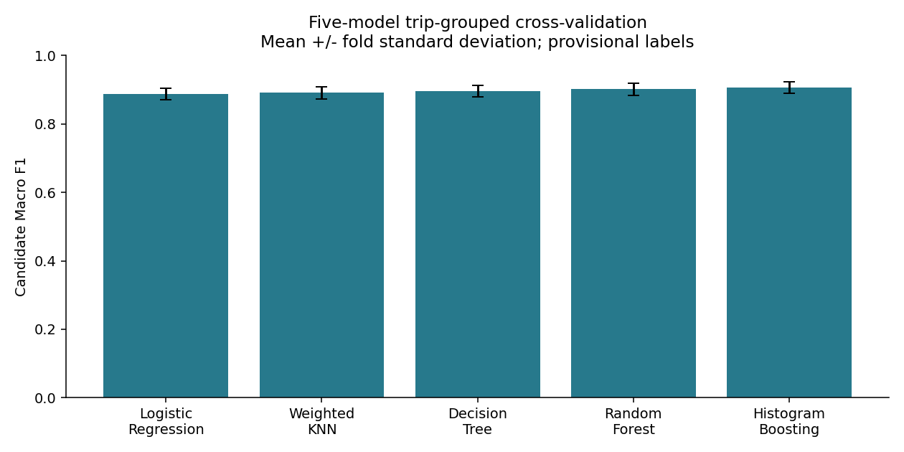

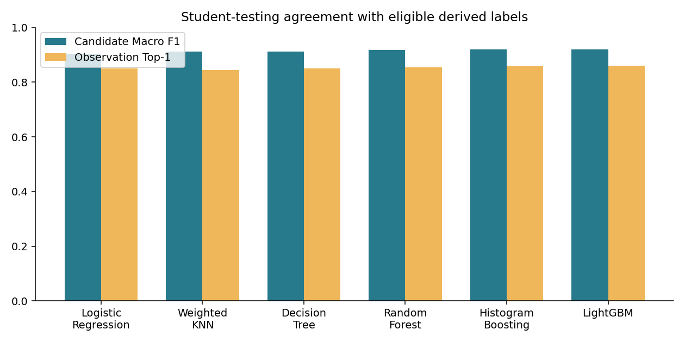

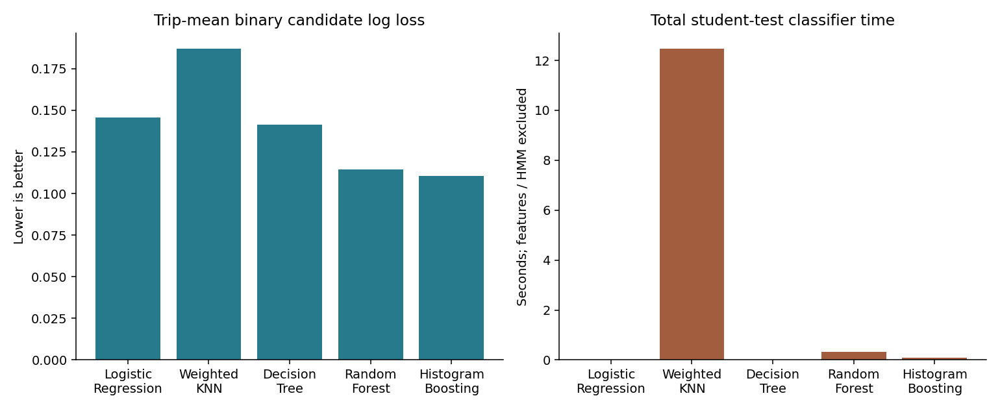

### Logistic Regression

A small probabilistic baseline tests whether geometric relationships are adequately linear. Standardisation makes the numerical feature scales comparable. Its linear boundary can miss interactions between heading reliability, distance and road structure.

**Evaluated configuration:** `{"C": 1.0, "max_iter": 500}`. Random seed 42 applies where supported; compute threads are limited to four.

**Objective:** L2-regularised binary logistic loss.

**Measured results:** CV candidate Macro F1 0.8874 +/- 0.0171; student-testing precision 0.9061, recall 0.9038, candidate Macro F1 0.9047, Top-1 0.8513 and binary log loss 0.1458. Combined five-fold fitting took 0.416 s; final fitting took 0.089 s; student classifier scoring took 0.0118 s on this machine.

**Fit/generalisation diagnostic:** pooled candidate Macro F1 on 10,000 sampled rows of the exact training matrix is 0.8863. This resubstitution statistic is optimistic and has a different aggregation from the trip-macro held-out scores. The fold standard deviation is 0.0171; inspect per-trip results rather than attributing the difference solely to overfitting. These diagnostics do not establish whether the model has exhausted its capacity or generalises to independently labelled routes.

### Distance-weighted KNN

Neighbour voting tests whether locally similar candidate configurations share compatibility labels. Standardisation is necessary for meaningful distance. Prediction must search retained training examples, and correlated geometric features can distort neighbour distance.

**Evaluated configuration:** `{"algorithm": "kd_tree", "leaf_size": 40, "n_neighbors": 15, "weights": "distance"}`. Random seed 42 applies where supported; compute threads are limited to four.

**Objective:** No iterative training loss; inverse-distance neighbour voting in scaled feature space.

**Measured results:** CV candidate Macro F1 0.8912 +/- 0.0178; student-testing precision 0.9137, recall 0.9093, candidate Macro F1 0.9114, Top-1 0.8453 and binary log loss 0.1871. Combined five-fold fitting took 0.837 s; final fitting took 0.224 s; student classifier scoring took 12.4797 s on this machine.

**Fit/generalisation diagnostic:** pooled candidate Macro F1 on 10,000 sampled rows of the exact training matrix is 1.0000. This resubstitution statistic is optimistic and has a different aggregation from the trip-macro held-out scores. The fold standard deviation is 0.0178; inspect per-trip results rather than attributing the difference solely to overfitting. These diagnostics do not establish whether the model has exhausted its capacity or generalises to independently labelled routes. KNN queries include the fitted examples themselves in this diagnostic, so near-perfect training agreement can reflect interpolation.

### Decision Tree

A bounded tree can learn readable nonlinear rules over distance, heading and candidate context. A single tree is sensitive to the training sample and can produce abrupt probability changes; the depth/leaf constraints limit memorisation.

**Evaluated configuration:** `{"max_depth": 10, "min_samples_leaf": 20}`. Random seed 42 applies where supported; compute threads are limited to four.

**Objective:** Greedy Gini impurity reduction with depth and leaf-size constraints.

**Measured results:** CV candidate Macro F1 0.8958 +/- 0.0174; student-testing precision 0.9135, recall 0.9119, candidate Macro F1 0.9126, Top-1 0.8511 and binary log loss 0.1413. Combined five-fold fitting took 1.905 s; final fitting took 0.490 s; student classifier scoring took 0.0064 s on this machine.

**Fit/generalisation diagnostic:** pooled candidate Macro F1 on 10,000 sampled rows of the exact training matrix is 0.9121. This resubstitution statistic is optimistic and has a different aggregation from the trip-macro held-out scores. The fold standard deviation is 0.0174; inspect per-trip results rather than attributing the difference solely to overfitting. These diagnostics do not establish whether the model has exhausted its capacity or generalises to independently labelled routes.

### Random Forest

Averaged bootstrapped trees reduce the instability of a single tree while modelling feature interactions. More trees increase storage and prediction cost; their averaged probabilities are not automatically calibrated.

**Evaluated configuration:** `{"max_depth": 14, "max_features": "sqrt", "min_samples_leaf": 10, "n_estimators": 100}`. Random seed 42 applies where supported; compute threads are limited to four.

**Objective:** Bootstrap-trained trees with Gini splits, averaging class probabilities.

**Measured results:** CV candidate Macro F1 0.9015 +/- 0.0180; student-testing precision 0.9256, recall 0.9102, candidate Macro F1 0.9175, Top-1 0.8536 and binary log loss 0.1146. Combined five-fold fitting took 10.403 s; final fitting took 2.853 s; student classifier scoring took 0.3120 s on this machine.

**Fit/generalisation diagnostic:** pooled candidate Macro F1 on 10,000 sampled rows of the exact training matrix is 0.9193. This resubstitution statistic is optimistic and has a different aggregation from the trip-macro held-out scores. The fold standard deviation is 0.0180; inspect per-trip results rather than attributing the difference solely to overfitting. These diagnostics do not establish whether the model has exhausted its capacity or generalises to independently labelled routes.

### Histogram Gradient Boosting

Histogram-based boosting combines nonlinear feature rules and handles continuous geometric inputs without scaling. Its iteration count, learning rate and leaf settings require validation. Internal row-split early stopping is disabled to preserve the external trip-group protocol.

**Evaluated configuration:** `{"early_stopping": false, "l2_regularization": 1.0, "learning_rate": 0.08, "max_iter": 120, "max_leaf_nodes": 15, "min_samples_leaf": 30}`. Random seed 42 applies where supported; compute threads are limited to four.

**Objective:** Stagewise minimisation of binary log loss, with L2 regularisation and a fixed iteration budget.

**Measured results:** CV candidate Macro F1 0.9056 +/- 0.0171; student-testing precision 0.9225, recall 0.9187, candidate Macro F1 0.9205, Top-1 0.8591 and binary log loss 0.1104. Combined five-fold fitting took 1.982 s; final fitting took 0.467 s; student classifier scoring took 0.0939 s on this machine.

**Fit/generalisation diagnostic:** pooled candidate Macro F1 on 10,000 sampled rows of the exact training matrix is 0.9112. This resubstitution statistic is optimistic and has a different aggregation from the trip-macro held-out scores. The fold standard deviation is 0.0171; inspect per-trip results rather than attributing the difference solely to overfitting. These diagnostics do not establish whether the model has exhausted its capacity or generalises to independently labelled routes.

### LightGBM

LightGBM models nonlinear interactions among distance, heading and road context with histogram-based, leaf-wise boosted trees. Leaf count, minimum leaf size and regularisation constrain complexity. Its candidate compatibility scores supply emissions to the shared sequence decoder.

**Evaluated configuration:** `{"boosting_type": "gbdt", "deterministic": true, "force_col_wise": true, "learning_rate": 0.11884640362789968, "max_bin": 255, "min_child_samples": 70, "n_estimators": 91, "n_jobs": 4, "num_leaves": 25, "objective": "binary", "random_state": 42, "reg_lambda": 0.6158459876169441, "verbosity": -1}`. Random seed 42 applies where supported; compute threads are limited to four.

**Objective:** Binary log loss with leaf-wise gradient boosting and L2 regularisation.

**Measured results:** CV candidate Macro F1 0.9053 +/- 0.0174; student-testing precision 0.9223, recall 0.9187, candidate Macro F1 0.9203, Top-1 0.8596 and binary log loss 0.1099. Combined five-fold fitting took 2.308 s; final fitting took 0.590 s; student classifier scoring took 0.1285 s on this machine.

**Fit/generalisation diagnostic:** pooled candidate Macro F1 on 10,000 sampled rows of the exact training matrix is 0.9189. This resubstitution statistic is optimistic and has a different aggregation from the trip-macro held-out scores. The fold standard deviation is 0.0174; inspect per-trip results rather than attributing the difference solely to overfitting. These diagnostics do not establish whether the model has exhausted its capacity or generalises to independently labelled routes.

### Model selection

Histogram Gradient Boosting achieved the highest mean training-CV candidate Macro F1 (0.9056) and was selected for optimisation using that predeclared objective. The decision did not depend on the student-testing ranking. This is selection for provisional-label compatibility, not proof of the best decoded route quality.

### Bayesian hyperparameter optimisation

The optimiser uses a Gaussian-process surrogate with a Matérn kernel (nu=2.5), observation noise and expected improvement. It starts with four random trials; later trials maximize expected improvement over 1,024 sampled search points. This is an actual sequential Bayesian search; every objective below was measured by refitting all five training folds.

| Parameter | Lower | Upper | Distribution |
| --- | --- | --- | --- |
| learning_rate | 0.02 | 0.2 | log |
| max_leaf_nodes | 7 | 47 | int |
| min_samples_leaf | 10 | 80 | int |
| l2_regularization | 0.001 | 10 | log |
| max_iter | 80 | 200 | int |

12 trials were attempted, 12 completed, and 8 completed trials were GP-proposed. Total measured search wall time was 53.63 seconds. Best actual trial: 1. Best settings: `{"l2_regularization": 0.6158459876169441, "learning_rate": 0.11884640362789968, "max_iter": 91, "max_leaf_nodes": 25, "min_samples_leaf": 70}`. Search settings, proposal details, warnings, durations and each fold objective are saved in `bayesian_search.json` and `bayesian_trials.json`.

| Measure | Untuned | Best tuning trial |
| --- | --- | --- |
| CV candidate Macro F1 | 0.9056 | 0.9051 |
| Student candidate Macro F1 | 0.9205 | 0.9214 |
| Student observation Top-1 | 0.8591 | 0.8599 |
| Student binary log loss | 0.1104 | 0.1094 |
| Student classifier time (s) | 0.0939 | 0.0751 |

The exported final bundle uses `hist_gradient_boosting.joblib` according to the higher training-CV objective, retaining the baseline on a tie. CV changed by -0.0006; student Top-1 changed by +0.0008. These small differences are descriptive; no statistical significance claim is made.

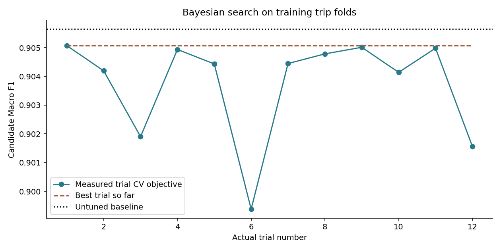

### Diagnostics and figures

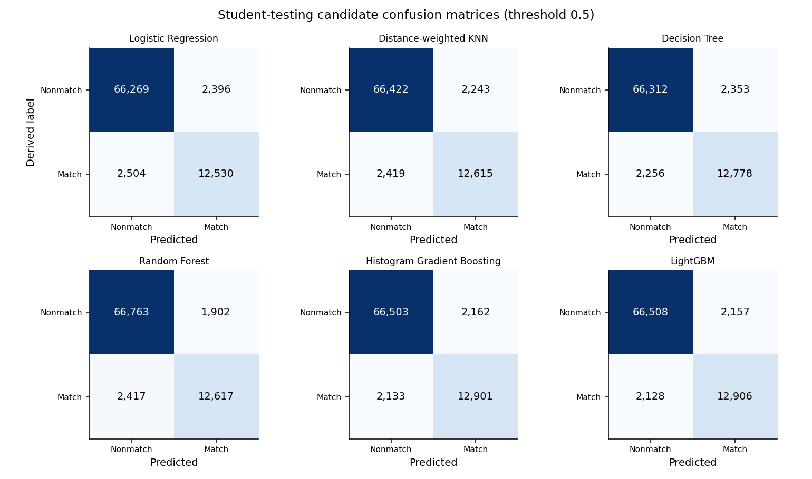

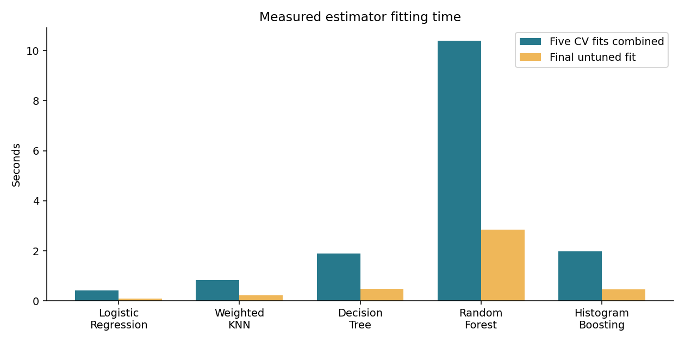

No epoch training/validation curves were fabricated. The selected estimators were run without a recorded epoch-wise validation history. Confusion matrices use actual final-model student candidate predictions and the fixed 0.5 threshold.

### Boosted classifier tuning and route evaluation

The classifiers use the same 16 features, candidates and labels, five trip folds, and observation sampling. LightGBM 4.6.0 fitting used 16,000 observations and 96,698 candidate rows across 80 training trips. All ten student trips were evaluated after training CV selected its settings.

HGB and LightGBM each used a baseline and 12 Bayesian trials. Each search initialized four trials randomly and proposed eight using GP expected improvement. Corresponding search bounds were learning_rate 0.02–0.2 (log), num_leaves/max_leaf_nodes 7–47, min_child_samples/min_samples_leaf 10–80, reg_lambda/l2_regularization 0.001–10 (log), and n_estimators/max_iter 80–200.

Selected LightGBM configuration: n_estimators=91, learning_rate=0.11884640362789968, num_leaves=25, min_child_samples=70, reg_lambda=0.6158459876169441. CPU fitting used four threads, seed 42, deterministic column-wise training, binary objective, and max_bin=255.

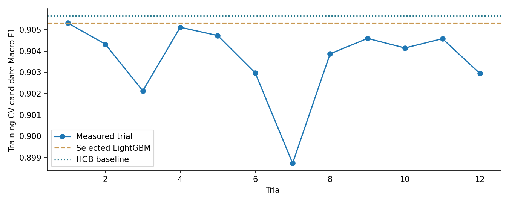

Both HGB and LightGBM were evaluated through the same frozen decoder. Decoder parameters were selected using HGB emissions on the declared training-trip development subset, so this comparison uses one common transition policy.

| Route metric | HGB | LightGBM |
| --- | --- | --- |
| CLASSIFIER Point agreement | 0.859105 | 0.859570 |
| CLASSIFIER Arc Macro F1 | 0.880029 | 0.884842 |
| CLASSIFIER Continuity | 0.913781 | 0.913625 |
| CLASSIFIER Sequence similarity | 0.442851 | 0.442167 |
| HMM Point agreement | 0.903570 | 0.904234 |
| HMM Arc Macro F1 | 0.920637 | 0.922637 |
| HMM Continuity | 0.997493 | 0.997493 |
| HMM Sequence similarity | 0.756493 | 0.753936 |

Decoded point agreement was 13,615/15,068 for HGB and 13,625/15,068 for LightGBM. LightGBM improved four trips, tied three, and scored lower on three. These labels are provisional ordered-route alignments and share geometric cues with model features. All 19,160 GPS observations received predictions. The reserved evaluator data was unavailable.

HGB is the application default under the selection rule of highest training grouped-CV candidate Macro F1. Timing comparisons use recorded runs and are machine-dependent.

Evidence is saved in results/lightgbm/model_comparison.csv, selected.json, protocol.json, bayesian_trials.json, route_comparison.json, and each model subdirectory. Reproduce with python scripts/run_lightgbm.py after cache preparation.

## 5 HMM and Viterbi reconstruction

A hidden state is an original directed road arc and its projected candidate position for an observation. The selected classifier provides uncalibrated binary compatibility probabilities. Clipped positive scores are normalized within each observation and used as emission potentials, not claimed as calibrated generative observation likelihoods.

Transition distance includes the unused part of the previous arc, a directed shortest path from its endpoint to the next arc start, and the used part of the next arc. Same-arc forward travel is handled directly. Backward projection jitter up to eight metres is treated as zero travel; larger backward moves require a legal directed cycle. Parallel roads and opposite directions remain distinct states. Bounds are min(5,000 m, 70 m/s * elapsed time + 40 m). Zero-length edges remain traversable without causing predecessor cycles.

For feasible transitions, the unnormalized log potential is -abs(network_distance - GPS_displacement) / beta, minus a 1.5 penalty for directly reversing an arc. Outgoing feasible transition potentials are normalized by log-sum-exp. Viterbi uses V[t,j] = emission_weight * log_emission[t,j] + max_i(V[t-1,i] + log_transition[i,j]); backpointers reconstruct the globally best candidate chain within each uninterrupted segment.

No candidates preserve an unmatched observation (-1). Gaps above 60 seconds restart the sequence. If no finite transition exists from the active predecessor states, the previous chain is finalized and a new chain begins. Route rendering adds actual shortest-path road segments between matched positions and shows disconnected pieces separately; it never draws a straight bridge across an impossible connection.

### Decoder parameter development

The classifier remained frozen. Six configurations varied beta in {15,30,60} metres and emission weight in {1,2}. Eight training trips with at most 1,500 observations were chosen with seed 42. Their IDs were 00000004, 00000005, 00000037, 00000047, 00000051, 00000058, 00000071, 00000088. Selection maximized mean eligible pointwise agreement, with continuity as tie-breaker. This uses training trips already seen by the classifier and is an optimistic development objective, not an independent generalisation estimate. Student testing and evaluator testing were not used to choose decoder parameters.

| Beta (m) | Emission weight | Training point agreement | Training continuity |
| --- | --- | --- | --- |
| 15.0 | 1.0 | 0.9060 | 0.9978 |
| 15.0 | 2.0 | 0.9052 | 0.9978 |
| 30.0 | 1.0 | 0.9023 | 0.9978 |
| 30.0 | 2.0 | 0.9052 | 0.9978 |
| 60.0 | 1.0 | 0.9002 | 0.9978 |
| 60.0 | 2.0 | 0.9035 | 0.9978 |

Selected decoder configuration: `{"backward_jitter_m": 8.0, "distance_cache_entries": 512, "distance_slack_m": 40.0, "emission_weight": 1.0, "gap_reset_s": 60.0, "max_speed_mps": 70.0, "maximum_path_m": 5000.0, "transition_beta_m": 15.0, "u_turn_penalty": 1.5}`.

### Classifier and decoder comparison

| Measure | Classifier only | Classifier + HMM |
| --- | --- | --- |
| Eligible observation Top-1 | 0.8591 | 0.9036 |
| Trip-mean local arc Macro F1 | 0.8800 | 0.9206 |
| Feasible route continuity | 0.9138 | 0.9975 |
| Trip-mean ordered edit similarity | 0.4429 | 0.7565 |
| Unmatched observations | 0 | 0 |

Pointwise scores use the same eligible subset for both methods; candidate misses count as errors. Arc Macro F1 uses reference arc classes within each trip, then averages trips; it is distinct from binary candidate Macro F1 in the classifier table. Continuity divides finite, movement-bounded transitions by all adjacent observation pairs with elapsed time at most 60 seconds; unmatched or disconnected positions fail and long gaps are reported separately. Sequence similarity is 1 - Levenshtein distance / maximum sequence length, comparing ordered arc visits and preserving nonconsecutive revisits. Consecutive duplicates are collapsed. Connected intermediate arcs enter the predicted sequence. Disconnected pieces are flattened for this declared sequence metric; their breaks remain visible and are penalized by continuity.

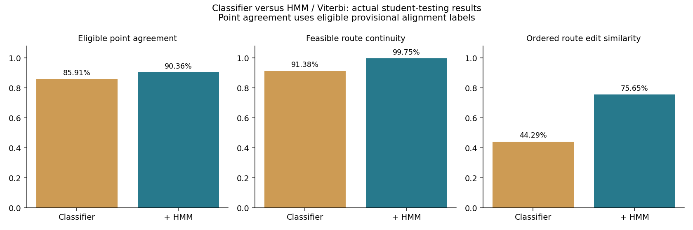

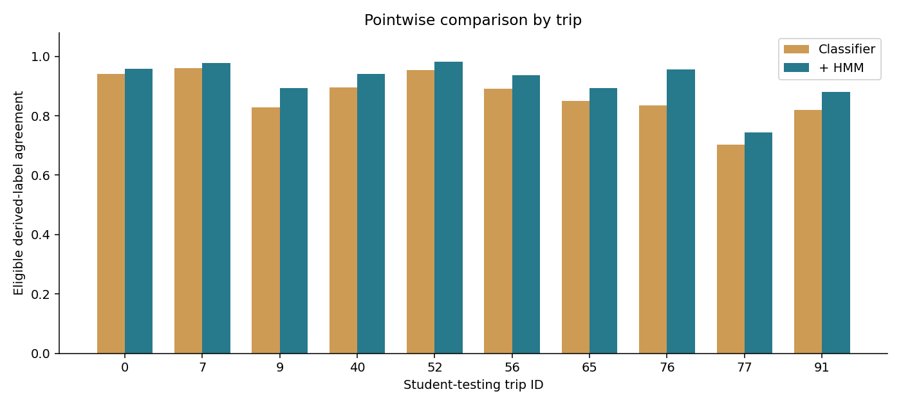

| Trip | GPS points | Eligible | Classifier Top-1 | HMM Top-1 | HMM continuity | HMM sequence |
| --- | --- | --- | --- | --- | --- | --- |
| 00000000 | 2503 | 2375 | 0.9402 | 0.9575 | 0.9992 | 0.6967 |
| 00000007 | 1354 | 1136 | 0.9604 | 0.9771 | 0.9904 | 0.8345 |
| 00000009 | 1049 | 704 | 0.8281 | 0.8935 | 0.9962 | 0.8150 |
| 00000040 | 2995 | 2735 | 0.8943 | 0.9411 | 0.9980 | 0.8284 |
| 00000052 | 262 | 215 | 0.9535 | 0.9814 | 1.0000 | 0.9789 |
| 00000056 | 3958 | 2806 | 0.8913 | 0.9366 | 0.9985 | 0.9123 |
| 00000065 | 768 | 597 | 0.8492 | 0.8928 | 0.9961 | 0.7754 |
| 00000076 | 1486 | 1015 | 0.8355 | 0.9567 | 1.0000 | 0.6796 |
| 00000077 | 3911 | 2800 | 0.7032 | 0.7436 | 0.9967 | 0.3313 |
| 00000091 | 874 | 685 | 0.8204 | 0.8803 | 0.9989 | 0.7128 |

Within the eligible subset, HMM corrected 1,200 previously wrong point assignments and changed 530 previously correct ones to incorrect assignments. Overall improvement therefore does not mean every decoding change helped. The lowest student HMM point agreement was on trip 00000077, at 0.7436. Ambiguous geometry, reference alignment limitations, local candidate misses and imperfect road connectivity remain failure modes. These counts use the saved provisional alignment audits.

## 6 Geographical visualisation with Folium

Interactive Folium HTML maps were generated from actual inference for all ten student-testing trips under results/full/maps. Layers distinguish raw GPS (blue), road geometry (gray), supplied development reference (purple), classifier (amber) and HMM (teal), with start/end markers, legend, layer controls and fitted bounds. References are permitted development comparisons only; this directory is not mounted by FastAPI. The optional OpenStreetMap layer is off by default. Folium viewer libraries use their standard CDN assets, so opening the HTML may require Internet even though vectors are embedded. The live UI offers OpenStreetMap tiles for development trips and a local road-network view for evaluator trips or offline use.

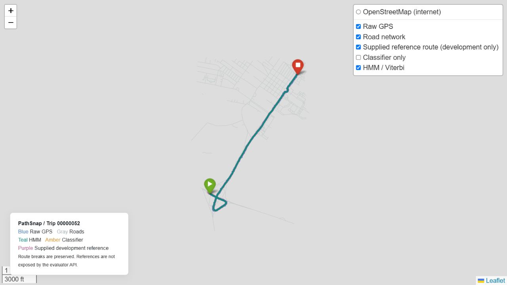

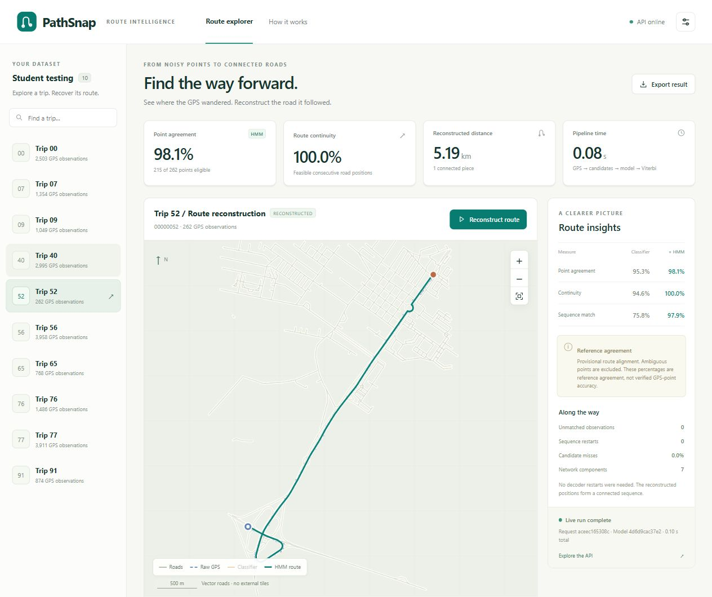

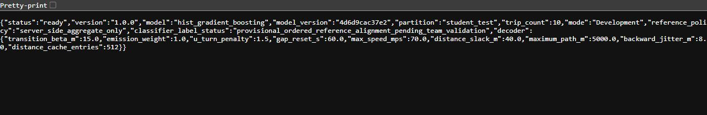

## 7 API UI deployment and reproducibility

FastAPI implements GET /health, GET /trips and POST /predict with an eight-digit trip ID and an optional classifier. Saved models load at startup. Every prediction request runs fresh GPS and network inference. The server records request and trip IDs, classifier and version, outcome and timings. Static serving is restricted to ui/. Reference failures leave predictions available and mark scoring unavailable.

The UI supports all trips in the configured partition, a six-model classifier selector, API connection settings, raw GPS, classifier and HMM layers, keyboard and pointer map navigation, trajectory replay, metrics and JSON export. The API keeps reference routes and pointwise correctness on the server. Point agreement derived from ordered routes is marked provisional.

Run scripts/start_api.ps1 on Laptop 1 (add -Lan for LAN binding); on Laptop 2 run scripts/start_ui.ps1, open localhost:8001 and set the API address to Laptop 1. Set PATHSNAP_ALLOWED_ORIGINS if using a different UI origin. Use scripts/setup.ps1 and requirements-lock.txt for dependencies. Deployment instructions and evaluator data/reference conventions are in DEPLOYMENT.md.

Automated checks: 34 tests executed, 0 failures, 0 errors. The tests cover graph direction, partial distances, parallel/zero-length edges, decoder gaps/unmatched states, sequence metrics, API validation/CORS, reference separation, and optional official label CSVs.

Live HTTP smoke check: all 10 student-testing trips returned successful predictions, covering 19,160 observations. Saved request IDs and real timings are in api_smoke_summary.json. Unknown-trip and malformed-ID checks returned 404 and 422 respectively.

Pure prediction time across ten student trips ranged from 0.155 to 1.300 seconds (median 0.515) on the development machine. The team still needs to rehearse the physical two-laptop setup and capture its receiving-laptop terminal during that run.

## 8 Reserved evaluator results

6 saved classifiers processed 10 reserved trips with 19,674 GPS observations per classifier. All 60 fresh prediction requests succeeded over HTTP. The same frozen decoder was used for each classifier. The default remained Histogram Gradient Boosting under the training cross-validation rule.

Point agreement covers 14,831 eligible observations per model. Ordered route references support sequence scoring on 10 trips for each model.

Pointwise agreement based on ordered route alignment is provisional. Ambiguous GPS observations are excluded from that metric.

### Classifier only

| Classifier | Point agreement | Arc Macro F1 | Continuity | Sequence similarity |
| --- | --- | --- | --- | --- |
| Logistic Regression | 77.34% | 86.14% | 86.87% | 46.34% |
| Distance-weighted KNN | 77.63% | 86.33% | 87.18% | 46.19% |
| Decision Tree | 77.14% | 86.35% | 86.88% | 46.60% |
| Random Forest | 77.99% | 86.52% | 87.15% | 47.53% |
| Histogram Gradient Boosting | 77.86% | 87.03% | 87.17% | 47.71% |
| LightGBM | 78.09% | 87.85% | 87.28% | 47.59% |

### Classifier with HMM/Viterbi

| Classifier | Point agreement | Arc Macro F1 | Continuity | Sequence similarity |
| --- | --- | --- | --- | --- |
| Logistic Regression | 85.19% | 89.71% | 99.42% | 70.86% |
| Distance-weighted KNN | 84.76% | 89.66% | 99.42% | 69.91% |
| Decision Tree | 84.98% | 89.92% | 99.42% | 69.84% |
| Random Forest | 85.28% | 90.51% | 99.42% | 73.60% |
| Histogram Gradient Boosting | 85.44% | 90.41% | 99.42% | 73.65% |
| LightGBM | 85.61% | 90.76% | 99.42% | 73.51% |

Point agreement is pooled over eligible observations. Continuity is pooled over comparable adjacent observation pairs. Arc Macro F1 and sequence similarity are means across scored trips. The aggregate record includes model build identifiers and median prediction and request times.

## 9 Conclusions, limitations and team review

Directed graph transitions and sequence decoding improved both continuity and provisional-label agreement in the measured student-development comparison. The implementation is reproducible through saved source, model/configuration bundles, trip-grouped folds, Bayesian trial logs, decoder trials, per-trip outputs and plot-generation scripts. Label validation remains the most important prerequisite for a definitive accuracy claim. Spherical projection, limited candidate counts, sampled classifier training and imperfect references are practical limitations; official scoring conventions may change the measured results.

Member 1 reviews dataset interpretation, geometry, candidates and graph transitions; Member 2 reviews features, alignment, six classifiers and Bayesian optimisation; Member 3 reviews HMM, scoring, UI/API and deployment. All members must understand and defend the complete system. AI assistance was used to prepare code, analysis and report text; disclose it as required and review every claim against actual outputs. The public GitHub submission and organiser-specific submission actions are not performed by these local build scripts.

## 10 Technical references

[FastAPI static files](https://fastapi.tiangolo.com/tutorial/static-files/) and [CORS](https://fastapi.tiangolo.com/tutorial/cors/); [scikit-learn grouped CV](https://scikit-learn.org/stable/modules/generated/sklearn.model_selection.GroupKFold.html) and [Gaussian process regression](https://scikit-learn.org/stable/modules/generated/sklearn.gaussian_process.GaussianProcessRegressor.html); [PROJ azimuthal-equidistant projection](https://proj.org/en/stable/operations/projections/aeqd.html); [Folium layer control](https://python-visualization.github.io/folium/v0.20.0/user_guide/ui_elements/layer_control.html). The directed graph search is implemented locally with a heap and bounded source cache.
