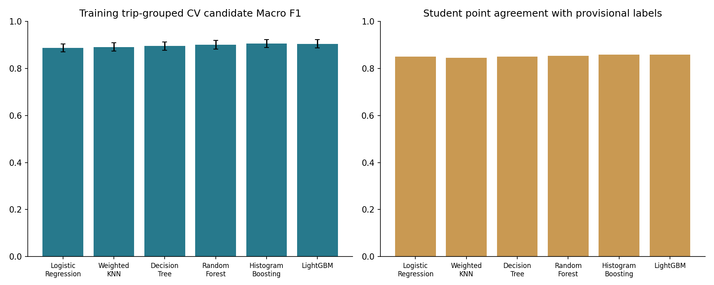
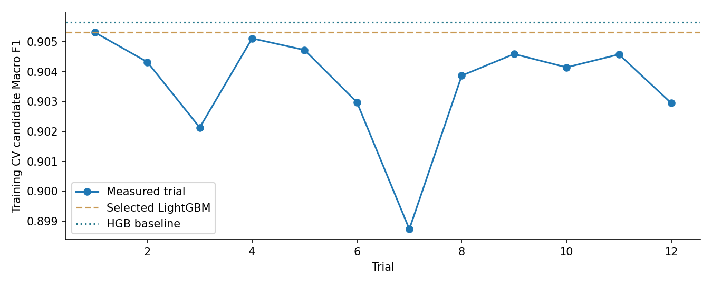

## Boosted classifier tuning and route evaluation

The classifiers use the same 16 features, candidates and labels, five trip folds, and observation sampling. LightGBM 4.6.0 fitting used 16,000 observations and 96,698 candidate rows across 80 training trips. All ten student trips were evaluated after training CV selected its settings.

| Model | CV candidate F1 | Student candidate F1 | Student Top-1 | Log loss |
| --- | --- | --- | --- | --- |
| Logistic Regression | 0.887401 | 0.904692 | 85.13% | 0.145763 |
| Distance-weighted KNN | 0.891221 | 0.911373 | 84.53% | 0.187142 |
| Decision Tree | 0.895788 | 0.912632 | 85.11% | 0.141255 |
| Random Forest | 0.901464 | 0.917506 | 85.36% | 0.114626 |
| Histogram Gradient Boosting | 0.905646 | 0.920494 | 85.91% | 0.110373 |
| LightGBM | 0.905305 | 0.920337 | 85.96% | 0.109940 |

HGB and LightGBM each used a baseline and 12 Bayesian trials. Each search initialized four trials randomly and proposed eight using GP expected improvement. Corresponding search bounds were learning_rate 0.02–0.2 (log), num_leaves/max_leaf_nodes 7–47, min_child_samples/min_samples_leaf 10–80, reg_lambda/l2_regularization 0.001–10 (log), and n_estimators/max_iter 80–200.

Selected LightGBM configuration: n_estimators=91, learning_rate=0.11884640362789968, num_leaves=25, min_child_samples=70, reg_lambda=0.6158459876169441. CPU fitting used four threads, seed 42, deterministic column-wise training, binary objective, and max_bin=255.

Both HGB and LightGBM were evaluated through the same frozen decoder. Decoder parameters were selected using HGB emissions on the declared training-trip development subset, so this comparison uses one common transition policy.

| Route metric | HGB | LightGBM |
| --- | --- | --- |
| CLASSIFIER Point agreement | 0.859105 | 0.859570 |
| CLASSIFIER Arc Macro F1 | 0.880029 | 0.884842 |
| CLASSIFIER Continuity | 0.913781 | 0.913625 |
| CLASSIFIER Sequence similarity | 0.442851 | 0.442167 |
| HMM Point agreement | 0.903570 | 0.904234 |
| HMM Arc Macro F1 | 0.920637 | 0.922637 |
| HMM Continuity | 0.997493 | 0.997493 |
| HMM Sequence similarity | 0.756493 | 0.753936 |

Decoded point agreement was 13,615/15,068 for HGB and 13,625/15,068 for LightGBM. LightGBM improved four trips, tied three, and scored lower on three. These labels are provisional ordered-route alignments and share geometric cues with model features. All 19,160 GPS observations received predictions.

HGB is the application default under the selection rule of highest training grouped-CV candidate Macro F1. Timing comparisons use recorded runs and are machine-dependent.

Evidence is saved in results/lightgbm/model_comparison.csv, selected.json, protocol.json, bayesian_trials.json, route_comparison.json, and each model subdirectory. Reproduce with python scripts/run_lightgbm.py after cache preparation.
