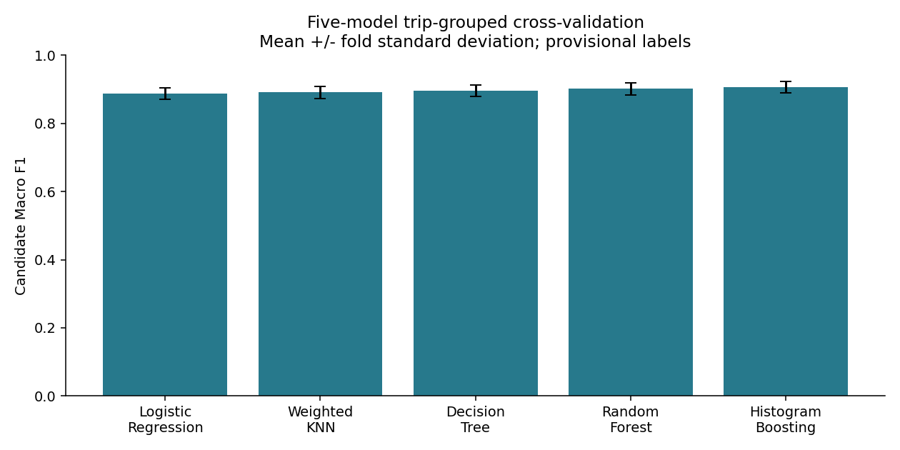
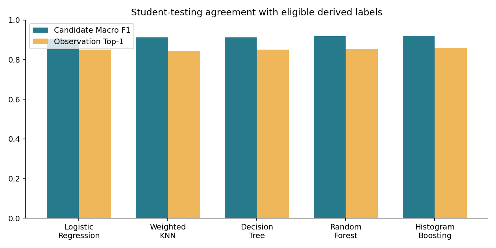
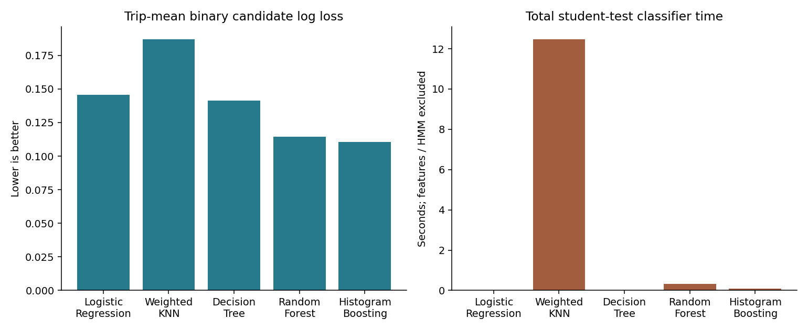
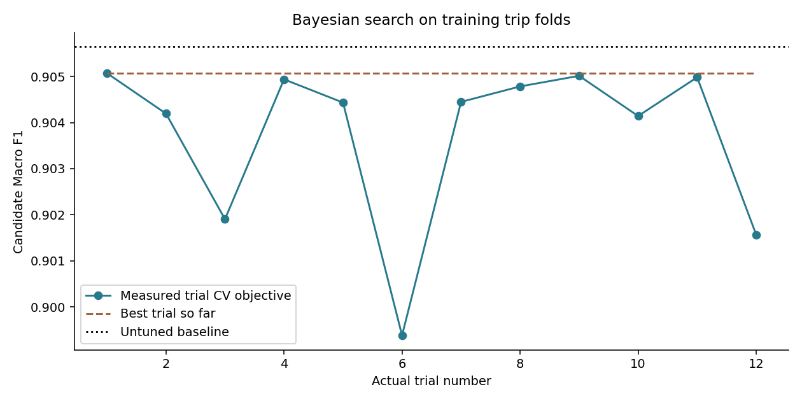
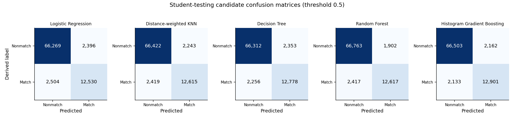
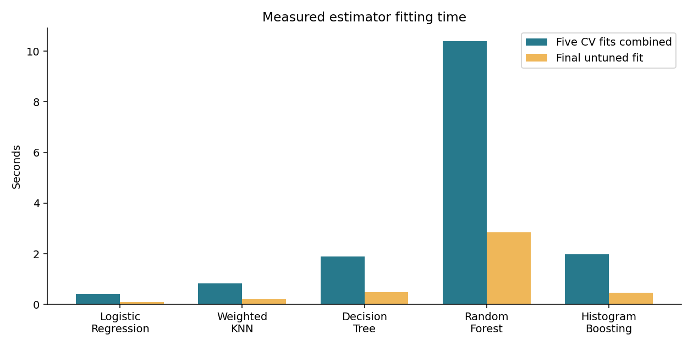

# Member 2 feature engineering model experiments and optimisation

These sections document the implementation and actual runs performed in this workspace. They are ready for team review and adaptation into the consolidated report; they do not cover Member 3's decoder, route metrics or deployed application.

## Status and interpretation

**All reference-based results below measure agreement with eligible provisional labels derived from the ordered supplied routes. They are not independently verified GPS-point accuracy.** No official pointwise mapping was supplied during this work. The same distance/heading geometry influences derived labels and input features, which can inflate measured agreement. Member 1 must review alignment quality; replace labels and rerun if an official mapping becomes available. Excluding ambiguous or distant observations also biases these results toward the more confidently aligned subset.

All 80 training trips and ten student-testing trips were processed. Training alignment accepted 146,211 of 208,417 observations; student-testing alignment accepted 15,068 of 19,160. Excluded points remain in inference outputs. Student-testing candidate miss rate on the eligible subset is 0.226%. Candidate policy was fixed before model comparison; no reference arc was added to validation candidates.

## Feature engineering

We model each observation-candidate pair as a binary compatibility problem. Arc IDs and trip IDs remain metadata. This supports road networks whose IDs are local to each trip. Features use GPS observations and road geometry only; no reference-route membership or reference-derived feature enters prediction.

`distance_m`, `heading_difference_rad`, `heading_valid`, `projection_fraction`, `road_length_m`, `from_in_degree`, `from_out_degree`, `to_in_degree`, `to_out_degree`, `speed_mps`, `time_gap_s`, `distance_rank`, `relative_distance_m`, `candidate_count`, `search_radius_m`, `zero_length_arc`.

Distances and fractions describe spatial fit. Directed heading difference disambiguates opposing arcs; a separate validity flag suppresses unreliable heading during low movement, anomalous speed or long gaps. Length and endpoint degrees describe road context. Speed and time gap describe sampling/motion conditions. Rank, relative distance, candidate count and search radius describe local competition. Zero-length arcs are flagged and projected without division by zero. The first point uses no future observation for its motion features.

The development geospatial adapter uses per-trip spherical azimuthal-equidistant coordinates and a sampled-segment spatial index with exact planar filtering. Candidate radius starts at 50 m and expands to 100/250 m only when no candidate exists; at most eight directed arcs are retained. This is a temporary Member 1 adapter pending shared geometry review, not an ellipsoidal projection or a guarantee of reference coverage.

## Reference label preparation

The offline aligner considers up to eight route occurrences per observation, scores geometric/heading compatibility and backtracks an ordered path through reference progress. Repeated arc occurrences are preserved. Large GPS gaps and infeasible progress cause explicit resets; reference discontinuities are kept as separate chunks. Eligibility requires a reference distance at most 50 m, an emission margin at least 0.15, local consistency and distance from reference-break endpoints. Post-initial resets are excluded. These are fixed provisional heuristics, not validated confidence probabilities. Per-point decisions are saved in `alignment_audits/` for manual review.

## Training and evaluation protocol

The five fixed group folds each hold out 16 complete training trips and fit on the remaining 64. Up to 200 eligible, candidate-covered observations per training trip are selected deterministically; all their candidates are retained. Each final untuned model fits 16,000 observations and 96,698 candidate rows drawn from all 80 trips. This is a laptop-budget experiment, not fitting every available GPS observation. CV evaluates up to 400 eligible observations per validation trip; student testing evaluates all eligible observations. Candidate misses remain observation-level errors. There is no observation weighting or class resampling after this group sampling.

StandardScaler is fit only inside each training fold for Logistic Regression and KNN. The tree estimators use the same unscaled feature matrix. Histogram Gradient Boosting internal early stopping is disabled. Candidate binary metrics use labels [nonmatch, match] and threshold 0.5; candidate metrics are averaged by trip. Top-1 accuracy is pooled across eligible observations. Folds and all sampling rules are identical across models. Model selection and the Bayesian objective use only training CV; student testing is the permitted development comparison. No evaluator-testing data was supplied or used.

## Five model comparison

| Model | Family | CV candidate F1 | Student precision | Student recall | Student F1 | Student Top-1 | Binary log loss | Classifier seconds |
| --- | --- | --- | --- | --- | --- | --- | --- | --- |
| Logistic Regression | Linear probabilistic | 0.8874 +/- 0.0171 | 0.9061 | 0.9038 | 0.9047 | 0.8513 | 0.1458 | 0.0118 |
| Distance-weighted KNN | Instance based | 0.8912 +/- 0.0178 | 0.9137 | 0.9093 | 0.9114 | 0.8453 | 0.1871 | 12.4797 |
| Decision Tree | Tree | 0.8958 +/- 0.0174 | 0.9135 | 0.9119 | 0.9126 | 0.8511 | 0.1413 | 0.0064 |
| Random Forest | Bagged tree ensemble | 0.9015 +/- 0.0180 | 0.9256 | 0.9102 | 0.9175 | 0.8536 | 0.1146 | 0.3120 |
| Histogram Gradient Boosting | Boosted tree ensemble | 0.9056 +/- 0.0171 | 0.9225 | 0.9187 | 0.9205 | 0.8591 | 0.1104 | 0.0939 |

CV values are fold means with standard deviation. Precision, recall and F1 are binary candidate Macro metrics; they are not arc-class Macro F1. Classifier seconds cover the ten student-testing trips' eligible candidate matrices, excluding raw-file loading, candidates, features and decoding. Log loss is binary candidate loss, not normalized observation loss. Route continuity is pending Member 3's integration and is not estimated here.

## Logistic Regression

A small probabilistic baseline tests whether geometric relationships are adequately linear. Standardisation makes the numerical feature scales comparable. Its linear boundary can miss interactions between heading reliability, distance and road structure.

**Initial configuration:** `{"C": 1.0, "max_iter": 500}`. Random seed 42 applies where supported; compute threads are limited to four.

**Objective:** L2-regularised binary logistic loss.

**Measured results:** CV candidate Macro F1 0.8874 +/- 0.0171; student-testing precision 0.9061, recall 0.9038, candidate Macro F1 0.9047, Top-1 0.8513 and binary log loss 0.1458. Combined five-fold fitting took 0.416 s; final fitting took 0.089 s; student classifier scoring took 0.0118 s on this machine.

**Fit/generalisation diagnostic:** pooled candidate Macro F1 on 10,000 sampled rows of the exact training matrix is 0.8863. This resubstitution statistic is optimistic and has a different aggregation from the trip-macro held-out scores. The fold standard deviation is 0.0171; inspect per-trip results rather than attributing the difference solely to overfitting. These diagnostics do not establish whether the model has exhausted its capacity or generalises to independently labelled routes.

## Distance-weighted KNN

Neighbour voting tests whether locally similar candidate configurations share compatibility labels. Standardisation is necessary for meaningful distance. Prediction must search retained training examples, and correlated geometric features can distort neighbour distance.

**Initial configuration:** `{"algorithm": "kd_tree", "leaf_size": 40, "n_neighbors": 15, "weights": "distance"}`. Random seed 42 applies where supported; compute threads are limited to four.

**Objective:** No iterative training loss; inverse-distance neighbour voting in scaled feature space.

**Measured results:** CV candidate Macro F1 0.8912 +/- 0.0178; student-testing precision 0.9137, recall 0.9093, candidate Macro F1 0.9114, Top-1 0.8453 and binary log loss 0.1871. Combined five-fold fitting took 0.837 s; final fitting took 0.224 s; student classifier scoring took 12.4797 s on this machine.

**Fit/generalisation diagnostic:** pooled candidate Macro F1 on 10,000 sampled rows of the exact training matrix is 1.0000. This resubstitution statistic is optimistic and has a different aggregation from the trip-macro held-out scores. The fold standard deviation is 0.0178; inspect per-trip results rather than attributing the difference solely to overfitting. These diagnostics do not establish whether the model has exhausted its capacity or generalises to independently labelled routes. KNN queries include the fitted examples themselves in this diagnostic, so near-perfect training agreement can reflect interpolation.

## Decision Tree

A bounded tree can learn readable nonlinear rules over distance, heading and candidate context. A single tree is sensitive to the training sample and can produce abrupt probability changes; the depth/leaf constraints limit memorisation.

**Initial configuration:** `{"max_depth": 10, "min_samples_leaf": 20}`. Random seed 42 applies where supported; compute threads are limited to four.

**Objective:** Greedy Gini impurity reduction with depth and leaf-size constraints.

**Measured results:** CV candidate Macro F1 0.8958 +/- 0.0174; student-testing precision 0.9135, recall 0.9119, candidate Macro F1 0.9126, Top-1 0.8511 and binary log loss 0.1413. Combined five-fold fitting took 1.905 s; final fitting took 0.490 s; student classifier scoring took 0.0064 s on this machine.

**Fit/generalisation diagnostic:** pooled candidate Macro F1 on 10,000 sampled rows of the exact training matrix is 0.9121. This resubstitution statistic is optimistic and has a different aggregation from the trip-macro held-out scores. The fold standard deviation is 0.0174; inspect per-trip results rather than attributing the difference solely to overfitting. These diagnostics do not establish whether the model has exhausted its capacity or generalises to independently labelled routes.

## Random Forest

Averaged bootstrapped trees reduce the instability of a single tree while modelling feature interactions. More trees increase storage and prediction cost; their averaged probabilities are not automatically calibrated.

**Initial configuration:** `{"max_depth": 14, "max_features": "sqrt", "min_samples_leaf": 10, "n_estimators": 100}`. Random seed 42 applies where supported; compute threads are limited to four.

**Objective:** Bootstrap-trained trees with Gini splits, averaging class probabilities.

**Measured results:** CV candidate Macro F1 0.9015 +/- 0.0180; student-testing precision 0.9256, recall 0.9102, candidate Macro F1 0.9175, Top-1 0.8536 and binary log loss 0.1146. Combined five-fold fitting took 10.403 s; final fitting took 2.853 s; student classifier scoring took 0.3120 s on this machine.

**Fit/generalisation diagnostic:** pooled candidate Macro F1 on 10,000 sampled rows of the exact training matrix is 0.9193. This resubstitution statistic is optimistic and has a different aggregation from the trip-macro held-out scores. The fold standard deviation is 0.0180; inspect per-trip results rather than attributing the difference solely to overfitting. These diagnostics do not establish whether the model has exhausted its capacity or generalises to independently labelled routes.

## Histogram Gradient Boosting

Histogram-based boosting combines nonlinear feature rules and handles continuous geometric inputs without scaling. Its iteration count, learning rate and leaf settings require validation. Internal row-split early stopping is disabled to preserve the external trip-group protocol.

**Initial configuration:** `{"early_stopping": false, "l2_regularization": 1.0, "learning_rate": 0.08, "max_iter": 120, "max_leaf_nodes": 15, "min_samples_leaf": 30}`. Random seed 42 applies where supported; compute threads are limited to four.

**Objective:** Stagewise minimisation of binary log loss, with L2 regularisation and a fixed iteration budget.

**Measured results:** CV candidate Macro F1 0.9056 +/- 0.0171; student-testing precision 0.9225, recall 0.9187, candidate Macro F1 0.9205, Top-1 0.8591 and binary log loss 0.1104. Combined five-fold fitting took 1.982 s; final fitting took 0.467 s; student classifier scoring took 0.0939 s on this machine.

**Fit/generalisation diagnostic:** pooled candidate Macro F1 on 10,000 sampled rows of the exact training matrix is 0.9112. This resubstitution statistic is optimistic and has a different aggregation from the trip-macro held-out scores. The fold standard deviation is 0.0171; inspect per-trip results rather than attributing the difference solely to overfitting. These diagnostics do not establish whether the model has exhausted its capacity or generalises to independently labelled routes.

## Model selection

Histogram Gradient Boosting achieved the highest mean training-CV candidate Macro F1 (0.9056) and was selected for optimisation using that predeclared objective. The decision did not depend on the student-testing ranking. This is selection for provisional-label compatibility, not proof of the best decoded route quality.

## Bayesian hyperparameter optimisation

The optimiser uses a Gaussian-process surrogate with a Matérn kernel (nu=2.5), observation noise and expected improvement. It starts with four random trials; later trials maximize expected improvement over 1,024 sampled search points. This is an actual sequential Bayesian search; every objective below was measured by refitting all five training folds.

| Parameter | Lower | Upper | Distribution |
| --- | --- | --- | --- |
| learning_rate | 0.02 | 0.2 | log |
| max_leaf_nodes | 7 | 47 | int |
| min_samples_leaf | 10 | 80 | int |
| l2_regularization | 0.001 | 10 | log |
| max_iter | 80 | 200 | int |

12 trials were attempted, 12 completed, and 8 completed trials were GP-proposed. Total measured search wall time was 53.63 seconds. Best actual trial: 1. Best settings: `{"l2_regularization": 0.6158459876169441, "learning_rate": 0.11884640362789968, "max_iter": 91, "max_leaf_nodes": 25, "min_samples_leaf": 70}`. Search settings, proposal details, warnings, durations and each fold objective are saved in `bayesian_search.json` and `bayesian_trials.json`.

| Measure | Untuned | Best tuning trial |
| --- | --- | --- |
| CV candidate Macro F1 | 0.9056 | 0.9051 |
| Student candidate Macro F1 | 0.9205 | 0.9214 |
| Student observation Top-1 | 0.8591 | 0.8599 |
| Student binary log loss | 0.1104 | 0.1094 |
| Student classifier time (s) | 0.0939 | 0.0751 |

The exported final bundle uses `hist_gradient_boosting.joblib` according to the higher training-CV objective, retaining the baseline on a tie. CV changed by -0.0006; student Top-1 changed by +0.0008. These small differences are descriptive; no statistical significance claim is made.

## Diagnostics and figures

No epoch training/validation curves were fabricated. The selected estimators were run without a recorded epoch-wise validation history. Confusion matrices use actual final-model student candidate predictions and the fixed 0.5 threshold.

## Integration and limitations

The bundle includes the classifier/pipeline, ordered feature schema, configuration, training trip IDs, software versions and run signature. The inference API accepts GPS/network-derived candidate features only, preserves keys and returns binary compatibility probabilities plus candidate-normalized positive emission potentials. These potentials are not calibrated generative HMM likelihoods. Member 3 must document their use, add Member 1's graph transitions, and measure decoder effects.

Remaining team work: validate/reference alignment with Member 1 or organisers; review geometry/projection assumptions; integrate Member 3's HMM; report route continuity and ordered sequence performance; run the actual two-laptop application; collect deployment/Folium evidence. The current ML outputs alone do not establish completion of those components.

## Reproducibility and evidence

Run signature: `380ea0a3d0feb1720099f20f5f3434f1406aa1d949e8869b2937f71cd991636e`. Python and library versions are recorded in `run_metadata.json`; this run used scikit-learn 1.9.1, NumPy 2.4.2 and 4 computational threads on Windows-10-10.0.26200-SP0. Timings are machine-specific.

Reproduce with the commands in `MEMBER2_README.md`. Sources of evidence: model_comparison.csv, cv_per_trip.csv, student_test_per_trip.csv, folds.json, preparation_summary.csv, per-model JSON records, Bayesian trial history, artifact metadata and alignment audits. The report text and code were prepared with AI assistance; the team must review the implementation and explain the actual results, and disclose assistance as required by event policy.

Technical references used for implementation: [scikit-learn GroupKFold](https://scikit-learn.org/stable/modules/generated/sklearn.model_selection.GroupKFold.html), [GaussianProcessRegressor](https://scikit-learn.org/stable/modules/generated/sklearn.gaussian_process.GaussianProcessRegressor.html), and [PROJ azimuthal-equidistant projection documentation](https://proj.org/en/stable/operations/projections/aeqd.html). The development spherical projection is implemented locally and does not call PROJ.

## Saved bundle verification

The saved final bundle was loaded and run from raw GPS/nodes/arcs on all 10 student-testing trips, covering 19,160 observations. Raw-input scores matched cached-feature scores. Measured per-trip end-to-end classifier pipeline latency ranged from 0.062 to 0.293 seconds, excluding HMM and the network/UI. The raw prediction path did not read reference routes. Full score and assignment exports are in `handoff_predictions/`; these are development diagnostics, not application lookup outputs.
